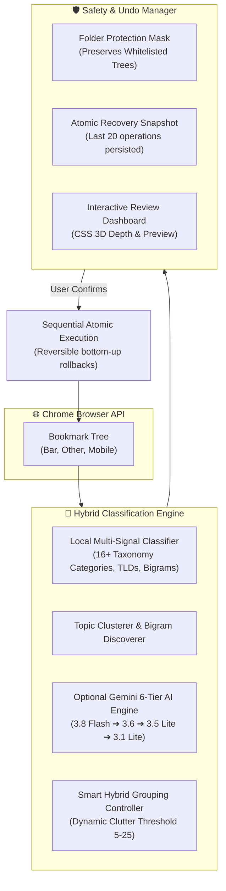

# 📑 Smart Bookmark Organizer — Chrome Extension (Manifest V3)

<div align="center">

[](manifest.json)
[](#running-tests)
[](#privacy--architecture-guarantees)
[](#automatic-gemini-fallback)
[](core/)
[](LICENSE)

**An intelligent, privacy-first, fully reversible Chrome extension for deep bookmark organization. Features local NLP tokenization, domain taxonomy clustering, smart hybrid grouping, optional Gemini AI fallback, and 1-click snapshot restore.**

[Quick Install](#-installation) • [Key Features](#-key-features) • [System Architecture](#-system-architecture) • [Organization Modes](#-organization-modes) • [AI Fallback](#-automatic-gemini-fallback) • [Workflow](#-everyday-workflow) • [Testing](#-running-tests)

</div>

---

## 🔒 Privacy & Architecture Guarantees

> [!TIP]
> **100% Offline by Default**: The entire categorization engine operates client-side using comprehensive domain dictionaries, URL path tokenizers, and NLP title extractors. Zero external network requests are made unless you explicitly connect your personal Gemini API key.

- **Zero Data Leakage**: When optional Gemini AI is enabled, all URLs are stripped of query strings (`?utm=...`) and URL fragments (`#...`). Local (`localhost`), private IPs (RFC 1918), and credentialed URLs are strictly filtered and never sent to external APIs.
- **Isolated Credential Storage**: API keys are saved in Chrome's isolated extension storage with dedicated 1-click removal.
- **Atomic Undo Snapshots**: A full hierarchy snapshot is persisted prior to any folder creation, link move, or deduplication.
- **Strictly Non-Destructive**: Bookmarks are never deleted without explicit confirmation dialogs.

---

## 🛠️ System Architecture



---

## ✨ Key Features

| Feature | Description |
|---|---|
| **🌲 Deep Recursive Traversal** | Recursively analyzes nested folder structures, bookmarks bar, other bookmarks, and mobile bookmarks across any depth. |
| **🏷️ Multi-Signal Local NLP** | Classifies links into 16+ rich categories (e.g., *AI & Tech, Programming, Study Abroad, Finance, Career, Research, Design, Tools*). |
| **🔀 Smart Hybrid Grouping** | Prevents over-nesting. Automatically flattens small categories (< 10 bookmarks) while neatly partitioning dense categories into targeted subfolders. |
| **🤖 6-Tier Gemini Failover** | Automatic cascading failover across 6 Gemini models (`3.8 Flash`, `3.6 Flash`, `3.5 Flash-Lite`, `3.7 Flash`, `3.5 Flash`, `3.1 Flash-Lite`) with exponential backoff cooldowns. |
| **🧹 Clutter Auto-Splitter** | Detects folders exceeding clutter thresholds (> 12 items) and groups them by shared domain roots or bigram topics. |
| **🔍 URL Normalization & Deduplication** | Identifies duplicate URLs regardless of trailing slashes, HTTP/HTTPS variance, and UTM tracking parameters. |
| **⏪ Instant 1-Click Rollback** | Dedicated Undo Manager stores up to 20 granular snapshots with bottom-up folder cleanup and JSON backup export/import. |
| **🎨 Tactile CSS 3D Dashboard** | Responsive dashboard featuring realistic folder depths, hover tilts, reduced-motion compliance, and zero heavy 3D dependencies. |

---

## 📂 Organization Modes

Configure your preferred folder structure under **Settings → Organization Style**:

```
1. Flat Mode
   ├── AI & Technology (all AI bookmarks flat)
   ├── Programming (all coding bookmarks flat)
   └── Finance (all trading & finance flat)

2. Hierarchical Mode
   ├── AI & Technology
   │   ├── LLMs & Prompting
   │   └── Machine Learning
   └── Programming
       ├── Python
       └── Frontend & Web

3. Smart Hybrid Mode (Default — Recommended)
   ├── AI & Technology (18 bookmarks -> auto-split into subfolders)
   │   ├── Computer Vision
   │   └── Models & Frameworks
   └── Finance (4 bookmarks -> kept clean & flat without subfolder clutter)
```

---

## 🤖 Automatic Gemini Fallback

When optional AI classification is enabled, requests follow a resilient fallback sequence:

```
[Gemini 3.8 Flash] ➔ [Gemini 3.6 Flash] ➔ [Gemini 3.5 Flash-Lite] ➔ [Gemini 3.7 Flash] ➔ [Gemini 3.5 Flash] ➔ [Gemini 3.1 Flash-Lite]
```

- **Per-request timeout**: 12 seconds per call.
- **Batch budget**: 75 seconds total limit per batch.
- **In-memory cooldown**: 60s for quota limits (`429`), 15m for missing models (`404`), and 15s for temporary connection faults.
- **Safe fallback**: If all AI models are exhausted, the extension seamlessly falls back to local heuristic rules without interrupting your flow.

---

## 🚀 Installation

1. Clone or download this repository.
2. Open Google Chrome and navigate to `chrome://extensions/`.
3. Toggle on **Developer mode** in the top right corner.
4. Click **Load unpacked** and select the `chrome extension` directory (`D:\AI STUFF\PROJECTS\chrome extension`).
5. Click the extension icon in your toolbar to launch the organizer!

---

## 🖥️ Everyday Workflow

1. **Review Before Organizing**:
   - The dashboard highlights strong matches (pre-selected) and displays uncertain suggestions with confidence scores and rationale.
   - Adjust suggested destinations inline or leave specific bookmarks in place.
2. **Execute Cleanly**:
   - Hit **Apply Changes**. The extension executes moves sequentially while recording current parents.
   - Use **Stop after current bookmark** at any time to pause mid-run without corrupting your hierarchy.
3. **Undo Anytime**:
   - Open **Undo History** to restore your bookmarks to their exact previous state with one click.
4. **Folder Reset Utility**:
   - Want a clean slate? Use **Settings → Maintenance → Reset Folders** to safely flatten your entire collection to the root bar before re-organizing.

---

## 🧪 Disposable UI Preview Server

Test and inspect the full UI without modifying your real browser bookmarks:

```powershell
node tests/preview-server.cjs
```
Open **http://127.0.0.1:8765/ui/dashboard.html** or **http://127.0.0.1:8765/ui/popup.html** to explore simulated bookmark trees.

---

## 🧪 Running Tests

```powershell
# Run 205 automated unit and safety tests
npm test

# Verify JavaScript syntax across all files
npm run syntax
```

---

## 📁 Repository Structure

```
chrome-bookmark-organizer/
├── background/
│   └── service-worker.js         # Manifest V3 service worker & alarms
├── core/
│   ├── bookmark-tree.js          # Deep tree traversal & execution engine
│   ├── categorizer.js            # Local heuristic scoring & NLP engine
│   ├── classification-evidence.js # Confidence & competing match scorer
│   ├── default-rules.js          # Predefined domain taxonomy & keyword maps
│   ├── folder-reset.js           # Safe flattening & root restoration
│   ├── gemini-service.js         # 6-tier AI client with cooldown management
│   ├── organization-safety.js    # Folder protection & execution validator
│   ├── storage.js                # Chrome storage synchronization wrapper
│   └── undo-manager.js           # Snapshot persistence & rollback manager
├── ui/
│   ├── dashboard.html            # Main organizer control center
│   ├── dashboard.js              # State manager & review controller
│   ├── dashboard.css             # Tactile 3D design system & themes
│   ├── depth.css / friendly.css  # Tactile visual enhancements
│   ├── popup.html / popup.js     # Lightweight toolbar launcher
│   └── popup.css                 # Popup styles
├── tests/                        # 205 Passing test cases
├── icons/                        # Extension icons (16px, 32px, 48px, 128px)
├── manifest.json                 # Manifest V3 configuration
└── README.md                     # Documentation
```

---

<div align="center">
  <sub>Built for effortless bookmark management, total privacy, and complete peace of mind.</sub>
</div>
